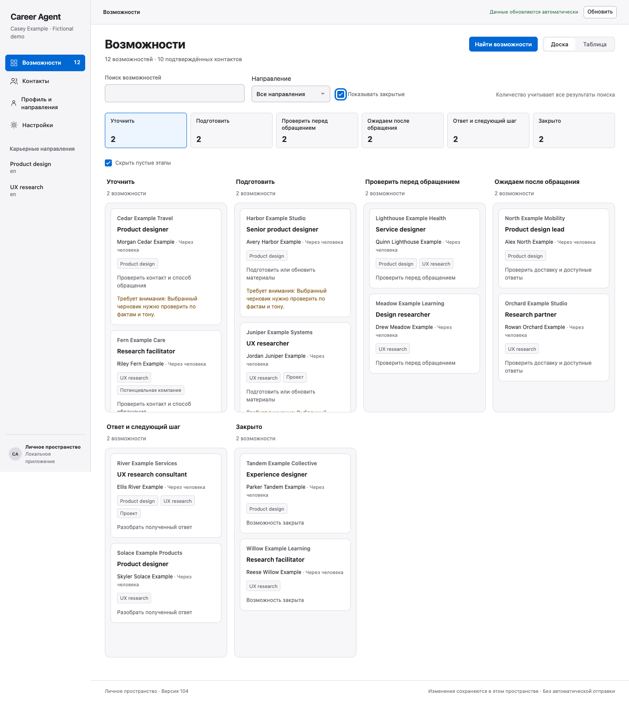
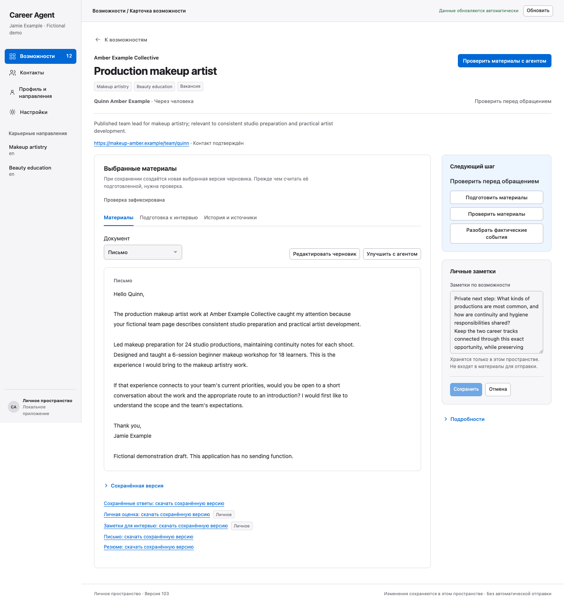
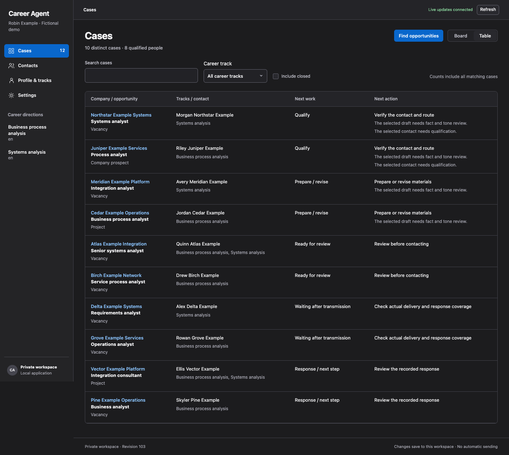
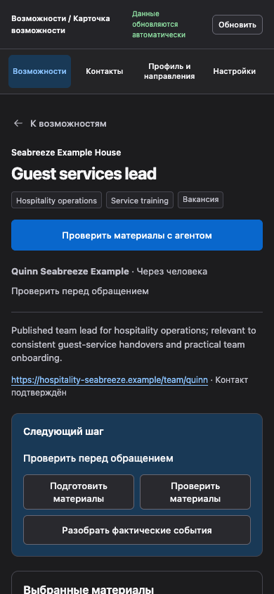

# Career Agent 1.0.8

Career work through conversation, with an installed private workspace and an optional local React interface. Build a source-backed profile, explore several professions, find useful people and opportunities, prepare selected materials, reconcile application history, and practice interviews. The model supplies evidence, meaning and writing; the local tools validate and persist records. Nothing sends applications or messages automatically.

The complete 1.0.8 platform archive is available from [the versioned release](https://github.com/luzanovdm/career-agent/releases/tag/v1.0.8). Only macOS arm64 has native clean-install acceptance evidence, on macOS 27.0.1. The declared macOS 11.0 minimum is untested; other platforms are not certified by this release. Existing private-workspace migration remains a separate, gated operation.

## Download and verify

Use [the complete macOS arm64 archive](https://github.com/luzanovdm/career-agent/releases/download/v1.0.8/career-agent-1.0.8-macos-arm64.zip), with its detached RELEASE.json and SHA256SUMS from the same release. The ZIP SHA256 is `2358fb4d490f0346ad5129b774e8ee9c90d30861555b73da620e96afb2ad9c11`. Verify locally before extraction or execution; the included bootstrap checks every managed file. Follow the included installed skill's installation reference through an agent with safe local execution. Use a new private workspace; legacy conversion is never automatic. The source checkout and its historical helpers are not a personal installation. Root release.json uses the 1.0 release-index format; the retired pre-1.0 descriptor/updater is not a compatibility path.

## Use through your agent

Load the complete platform bundle in a host that supports local execution, choose a private workspace outside this checkout, and choose UI locale. The agent verifies the exact archive and installs its bundled Python, prebuilt React assets and skill into that directory. Python and Node installations are not prerequisites for the installed app. After bootstrap, every application operation uses the workspace `.career-agent/career` launcher and the installed skill. Source/global execution is refused; explicit development mode is reserved for isolated fictional fixtures.

Talk in your preferred language. Document and interview languages are chosen separately per career track or role. English and Russian UI catalogs are included. Other translations can be created by the agent as validated workspace customizations and survive code updates. There is no translation service, account, hosted database, telemetry, external font or required paid integration.

The local interface uses React Aria Components throughout its interactive controls, with a shared visual layer, system fonts, keyboard support and system/light/dark themes. Board and table share selected records and SQLite transactions with the CLI. Simple edits save directly; complex research, writing and review actions show a scoped prompt to paste into your agent. Copying the prompt does not execute it or grant permission.

## One source of truth

| Workspace path | Responsibility |
| --- | --- |
| `Data/career.sqlite3` | Canonical entities, scoped answers, selected versions, activity history and durable changes |
| `Objects/` | Immutable content addressed by SHA-256, including source evidence and material versions |
| `Originals/` | Authorized original files kept outside release assets |
| `Views/` | Derived CSV, XLSX, profile and read-only snapshots; never a second editable campaign store |
| `Backups/` | Bounded verified automatic checkpoints in `Automatic/`; explicit portable/manual/migration archives remain separate |
| `.career-agent/` | Verified versioned runtime, active locator, bounded local-process control and mutable customizations |

Different people use different workspaces. Several tracks can share an evidence-backed claim bank without sharing scoped constraints or employer consent. Exact company/opportunity/person identity is preserved. Primary packet and selected version are explicit; later alternatives do not silently replace them. Prepared is not sent, receipt is not progress, and unknown response coverage is not silence. Uncertain transmissions block blind retries.

Sources, achievements, ownership qualifiers, metrics and meaningful secondary strengths remain inspectable. Included or condensed achievements must bind used claims to actual resume spans, including original numerical tokens and recognized units. Base audits are reused by immutable reference with explicit target overlays. These checks catch mechanical losses; the model must still review source meaning, unsupported qualitative assertions and tone and state its limitations. A readable user assertion is evidence of that assertion, not independent corroboration.

Research starts only after an explicit scoped choice and stops on pause/revocation. An unchanged grant survives a new chat. Forms are secondary to useful evidenced people and professional routes. There is no research worker, sender, submission path or agreement-acceptance path in the local runtime.

## Local lifecycle and safety

`ui open` starts or reuses a matching loopback-only process. `ui status`, `ui stop` and `ui restart` use private current-user control, never PID guesses. The app uses exact Host/Origin checks, run-scoped authentication, CSRF protection, bounded typed endpoints and CSP. CLI commits invalidate the UI through durable change-log SSE, with reconnect and polling fallback. Dirty edits remain available on conflicts and disconnects.

No privileged install, firewall changes, boot service or persistent credential is needed. Closing a chat does not stop the local interface. A restart invalidates old sessions. Assets and runtime stay version coherent; an old process never silently consumes a changing development build.

## Existing workspaces

Schema-1 JSON workspaces require the separate one-time offline importer under `maintenance/`. Rehearse only on restored disposable copies first. The importer inventories original bytes, normalizes recognized historical reference shapes individually, retains original records and quarantines unresolved references or semantics. Strict acceptance fails while quarantine remains. It does not activate the destination, manufacture current reviews, or silently drop data. Keep the original workspace and verified full backup authoritative until independent acceptance and writer handoff.

The historical JSON helpers and their regression fixtures remain in source for audit/import development. They are excluded from the 1.0 installed runtime and are not a compatibility execution path.

## Engineering and verification

See [development](docs/development.md), [architecture](docs/architecture.md), [storage](docs/storage.md), [API 1.0](docs/api/1.0.0.md), [performance](docs/state-performance.md) and the installed [skill](skills/career-agent/SKILL.md). Exact candidate hashes and passed/failed/not-run gates belong in the frozen acceptance report. Supported-platform declarations are not evidence of testing every platform or OS minimum.

UI screenshots and synthetic stories are maintained under `ui/demo-screenshots/` and `ui/demo/`. They show fictional beauty/training, hospitality, analysis and design careers; screenshots are illustrative evidence of the reviewed UI, not proof of backend release acceptance.

## Fictional interface examples

These captures use the independently reviewed kit4 UI and disposable fictional stories. Their observed backend is CP2; they illustrate available screens and do not serve as backend or installed-release acceptance proof.

The [capture manifest](ui/demo-screenshots/readme/manifest.json) records all twelve screens, selected build hashes, fictional personas, locales and viewports.
